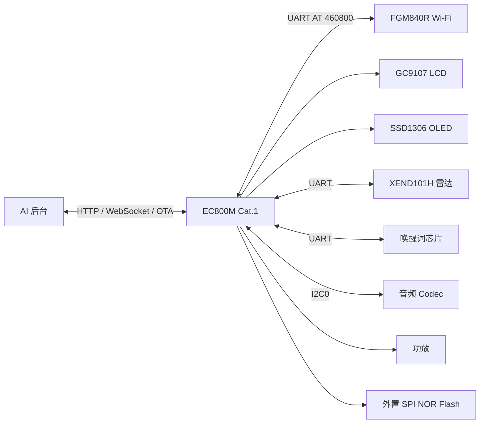

# 小新 AI 语音机器人（移远 EC800M / Cat.1 版）

这是「小新」AI 语音机器人的移远 EC800M 版本产品层源码，运行在 Quectel EC800M Cat.1 模组上（ASR1606 + ThreadX + QuecOpen C SDK），外挂 FGM840R Wi-Fi 模组。

> 本仓库**只包含产品层 `venus` 工程**，不包含移远 SDK、工具链、原厂固件和烧录工具。编译前需要先准备匹配版本的 QuecOpen SDK，详见 [编译说明](docs/build.md)。

## 系统架构



## 硬件规格

| 项目 | 参数 |
| --- | --- |
| 主控 | Quectel EC800MCN_LE，ASR1606，Cortex-R 系列 |
| 系统 | ThreadX + QuecOpen C SDK |
| 网络 | LTE Cat.1 4G + FGM840R Wi-Fi（独立固件） |
| 显示 | GC9107 LCD（SPI1）+ SSD1306 OLED（I2C2） |
| 音频 | I2C0 Codec + PA（GPIO124） |
| 雷达 | XEND101H，UART，OUT=GPIO22，LDO=GPIO23 |
| 唤醒词 | 独立唤醒词芯片，UART，INT=GPIO26，LDO=GPIO21 |
| 存储 | 外置 SPI NOR Flash（SPI2，CS=GPIO5） |
| 充电 | CHRG=GPIO14，STDBY=GPIO15，EN=GPIO1 |
| 触摸 | GPIO31 |
| 调试 | USB AT / DIAG / LOG / DOWNLOAD 多串口 |

引脚定义集中在 `venus/vn_plat_pin_def.h`，修改硬件时先核对原理图和该文件。

## 仓库内容

```text
.
├── venus/                     # 产品层源码
│   ├── app/                   # 主应用、小智状态机、显示、音频、Wi-Fi 应用
│   ├── bsp/                   # 板级驱动：LCD、OLED、雷达、音频、Wi-Fi、充电、Flash
│   ├── component/             # AT、HTTP、WebSocket、OTA、网络、队列
│   ├── xiaozhi/               # 小智协议与 OTA
│   ├── resource/              # GIF、Emoji、图标、字体、JPEG
│   ├── third_party/           # LVGL、Opus、Mongoose、EasyFlash、AT 框架
│   ├── vn_plat_pin_def.h      # 引脚定义
│   └── Makefile
├── integration/               # 放回 SDK 所需的构建集成文件和脚本
├── docs/                      # 硬件、编译、烧录、协议、调试、FAQ
├── THIRD_PARTY_LICENSES.md
└── README.md
```

## 不包含的内容

- 移远 `ql-sdk` 源码、芯片厂库、内核、bootloader
- ARMCC / GCC 工具链和 license
- 原厂固件、恢复烧录包
- 移远 QFlash、USB 驱动、官方 API 文档

这些需要从移远官方或你的方案商获取。具体版本和放置方式见 [编译说明](docs/build.md)。

## 快速开始

1. 准备 Windows 电脑和匹配版本的 QuecOpen C SDK。
2. 把 `venus/` 放到 SDK 的 `ql-application/threadx/venus`。
3. 按 [integration/README.md](integration/README.md) 修改 SDK 的父级 `Makefile`，并加入链接脚本。
4. 在 SDK 根目录执行：

   ```bat
   build.bat app clean
   build.bat app
   ```

5. 看到 `GCC Compiling Finished Sucessfully`，并在 `ql-application/threadx/build/` 得到 `app.elf`、`app.bin`、`app.map`。
6. 用 QFlash 烧录，详见 [烧录说明](docs/flashing.md)。

## 文档

| 文档 | 内容 |
| --- | --- |
| [硬件说明](docs/hardware.md) | 架构、外设、引脚、软件分层 |
| [编译说明](docs/build.md) | SDK 准备、目录放置、编译、产物 |
| [烧录说明](docs/flashing.md) | QFlash、AT+QDOWNLOAD、回滚、常见失败 |
| [协议说明](docs/protocol.md) | AT 命令、OTA/FOTA、Wi-Fi 模组 OTA |
| [调试说明](docs/debug.md) | AT 检查、日志、dump、地址还原 |
| [常见问题](docs/faq.md) | Wi-Fi 模组、A01/A02、烧录失败等 |

## 版本基线

- 设备型号：`EC800MCN_LE`
- 固件基线：`EC800MCNNR01A01SV08_DTN`
- 平台 SDK：`LTE01R06A17_C_SDK_A`

不同版本或不同尾缀的固件不要混用；烧录前必须确认硬件版本、分区、回滚策略和升级兼容性。

## 许可

产品层代码采用「个人非商业使用许可」：可以查看、修改、编译并用于个人自用，但不得用于商业用途。第三方组件遵循各自许可，详见 [LICENSE](LICENSE) 和 [THIRD_PARTY_LICENSES.md](THIRD_PARTY_LICENSES.md)。

## 免责声明

本仓库不包含移远的闭源 SDK、固件和工具。使用本工程需要自行取得合法的 SDK 和工具授权。因烧录、升级、硬件改装或第三方组件授权造成的任何损失，作者不承担责任。
