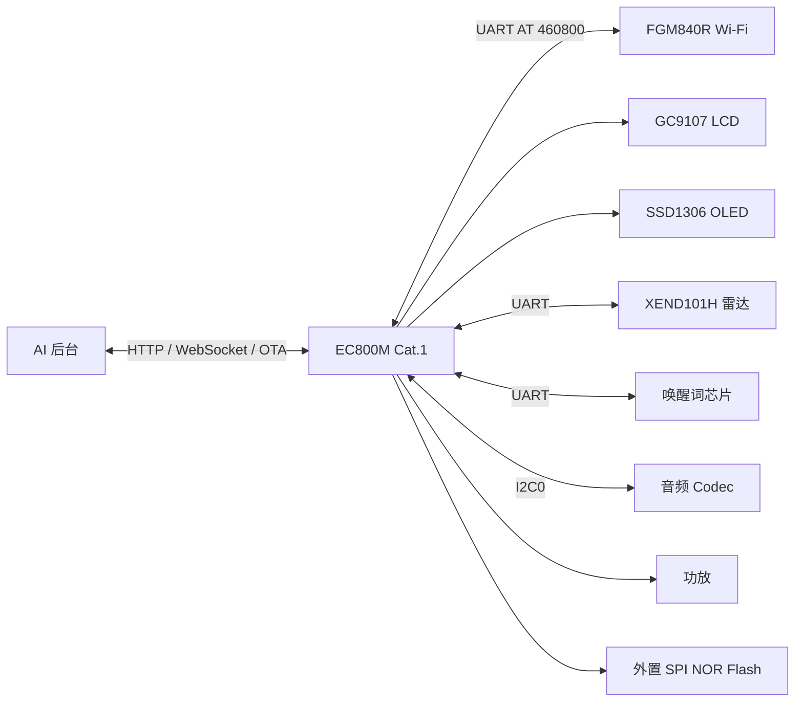

# 小新 AI 语音机器人（移远 EC800M / Cat.1 版）

一个基于 Quectel EC800M Cat.1 模组的 AI 语音机器人产品层工程。

主控 EC800M（ASR1606 + ThreadX + QuecOpen C SDK），外挂 FGM840R Wi-Fi 模组，板载 GC9107 LCD、SSD1306 OLED、XEND101H 雷达、独立唤醒词芯片和音频 Codec。设备通过 4G 或 Wi-Fi 连接后台，完成语音唤醒、录音上传、云端 ASR / LLM / TTS、表情显示和 OTA / FOTA。

> **本仓库定位**：产品层 `venus` 源码 + 板级驱动 + 开发文档。
> **不包含**移远 SDK、工具链、原厂固件和烧录工具。编译前需要准备匹配版本的 QuecOpen SDK，详见 [编译说明](docs/build.md)。

## 它能做什么

| 能力 | 现在就能用 | 你可以自己扩展 |
| --- | --- | --- |
| **语音对话** | 唤醒词芯片唤醒，录音上传，云端 ASR + LLM + TTS，Opus 播放 | 换唤醒词、换音色、接自己的后台 |
| **双网络** | 4G Cat.1 + FGM840R Wi-Fi，可切换 | 改 APN、改网络优先级、加 MQTT |
| **显示** | GC9107 LCD + SSD1306 OLED，表情 / 状态 | 改 UI、加页面、换字体、换 GIF |
| **雷达** | XEND101H 人体存在检测 | 改检测距离、加休眠 / 问候逻辑 |
| **音频** | I2C0 Codec + PA，Opus 编解码 | 换 Codec、改采样率、加 AEC |
| **OTA / FOTA** | 小智 OTA、Cell FOTA、Wi-Fi 模组 OTA | 接自己的 OTA 服务、改升级策略 |
| **AT 测试** | 音量、音频、Wi-Fi、OTA 测试命令 | 加自己的产测命令 |

## 系统架构



## 硬件规格

| 项目 | 参数 |
| --- | --- |
| 主控 | Quectel EC800MCN_LE，ASR1606，Cortex-R 系列 |
| 系统 | ThreadX + QuecOpen C SDK |
| 网络 | LTE Cat.1 4G + FGM840R Wi-Fi（独立固件） |
| 显示 | GC9107 LCD（SPI1）+ SSD1306 OLED（I2C2） |
| 音频 | I2C0 Codec + PA（GPIO124） |
| 雷达 | XEND101H，UART，OUT=GPIO22，LDO=GPIO23 |
| 唤醒词 | 独立唤醒词芯片，UART，INT=GPIO26，LDO=GPIO21 |
| 存储 | 外置 SPI NOR Flash（SPI2，CS=GPIO5） |
| 充电 | CHRG=GPIO14，STDBY=GPIO15，EN=GPIO1 |
| 触摸 | GPIO31 |

完整引脚表见 [硬件说明](docs/hardware.md)。

## 两种使用方式

### 方式一：只想使用设备

1. 安装 Quectel USB 驱动。
2. 打开 QFlash，加载恢复包。
3. 在 AT 口执行 `AT+QDOWNLOAD=1`，或选择 `Quectel Download Port`。
4. 点击 Start，等待 **100% PASS**。

详细步骤见 [烧录说明](docs/flashing.md)。

### 方式二：想自己开发

需要准备：

- Windows 电脑
- 匹配版本的移远 EC800M QuecOpen C SDK
- ARMCC / GCC 工具链和 license
- QFlash

然后把 `venus/` 放回 SDK，按 [integration/README.md](integration/README.md) 修改父级 Makefile 和链接脚本，执行：

```bat
build.bat app clean
build.bat app
```

详细步骤见 [编译说明](docs/build.md)。

> **注意**：本仓库不能开箱直接编译。SDK 不在仓库里，必须先从移远官方或方案商获取匹配版本。

## 卡住了先看这里

| 现象 | 检查方法 |
| --- | --- |
| 编译找不到 armcc | 解压 SDK 的 `ql-cross-tool/win32/owtoolchain`，或安装 DS-5 并配置 license |
| 编译路径过长 | 用 `subst` 把 SDK 映射成虚拟盘 |
| 链接地址错误 | 使用本仓库的 `integration/app_linkscript.ld` |
| QFlash 找不到端口 | 先执行 `AT+QDOWNLOAD=1`，选择 `Quectel Download Port` |
| QFlash `DL Time Out` | 端口选错或 Start / 上电时序不对 |
| `download.json: Inconsistent information` | ZIP 结构、顺序或元数据被改动 |
| 烧录后没变化 | 确认替换的是 `customer_app.bin`，确认 100% PASS |
| 设备反复重启 | 抓 dump，检查最近修改的音频 / 显示 / 网络代码 |
| Wi-Fi 不工作 | 确认 FGM840R 固件和 `AT+QGMR` 版本 |

更多问题见 [常见问题](docs/faq.md)。

## 仓库里有什么

```text
.
├── venus/                     # 产品层源码
│   ├── app/                   # 主应用、小智状态机、显示、音频、Wi-Fi 应用
│   ├── bsp/                   # LCD、OLED、雷达、音频、Wi-Fi、充电、Flash
│   ├── component/             # AT、HTTP、WebSocket、OTA、网络、队列
│   ├── xiaozhi/               # 小智协议与 OTA
│   ├── resource/              # GIF、Emoji、图标、字体、JPEG
│   ├── third_party/           # LVGL、Opus、Mongoose、EasyFlash、AT 框架
│   ├── vn_plat_pin_def.h      # 引脚定义
│   └── Makefile
├── integration/               # 放回 SDK 的链接脚本和脚本
├── docs/                      # 硬件、编译、烧录、协议、调试、FAQ
├── THIRD_PARTY_LICENSES.md
└── README.md
```

**不在仓库里的**：移远 `ql-sdk`、芯片厂库、内核、bootloader、ARMCC / GCC 工具链、原厂固件、恢复烧录包、QFlash、USB 驱动、官方 API 文档。

## 二次开发：改什么从哪里下手

| 想改什么 | 文件位置 |
| --- | --- |
| 引脚 | `venus/vn_plat_pin_def.h` |
| 主应用 / 主循环 | `venus/app/src/vn_main_app.c` |
| 小智状态机 | `venus/app/src/vn_xiaozhi_app.c` |
| 显示 / 表情 | `venus/app/src/vn_display.c`、`venus/bsp/vn_lcd`、`venus/bsp/vn_oled` |
| 音频 | `venus/bsp/vn_audio`、`venus/bsp/vn_opus` |
| Wi-Fi | `venus/bsp/vn_wifi`、`venus/app/src/vn_wifi_app.c` |
| 雷达 | `venus/bsp/vn_radar` |
| OTA / FOTA | `venus/component/vn_ota`、`venus/xiaozhi/src/vn_xiaozhi_ota.c` |
| AT 测试命令 | `venus/component/vn_at_cmd` |
| 后台地址 | `venus/app/src/vn_xiaozhi_app.c`、`venus/xiaozhi/src/vn_xiaozhi_ota.c` |

## 文档

| 文档 | 内容 |
| --- | --- |
| [硬件说明](docs/hardware.md) | 架构、外设、引脚、软件分层 |
| [编译说明](docs/build.md) | SDK 准备、目录放置、编译、产物 |
| [烧录说明](docs/flashing.md) | QFlash、AT+QDOWNLOAD、回滚、常见失败 |
| [协议说明](docs/protocol.md) | AT 命令、OTA/FOTA、Wi-Fi 模组 OTA |
| [调试说明](docs/debug.md) | AT 检查、日志、dump、地址还原 |
| [常见问题](docs/faq.md) | Wi-Fi 模组、A01/A02、烧录失败等 |
| [已验证环境](docs/verified-build.md) | 最近构建环境、已核对项、未验证项 |

## 版本基线

- 设备型号：`EC800MCN_LE`
- 固件基线：`EC800MCNNR01A01SV08_DTN`
- 平台 SDK：`LTE01R06A17_C_SDK_A`

不同版本或不同尾缀的固件不要混用；烧录前必须确认硬件版本、分区、回滚策略和升级兼容性。

## 许可

产品层代码采用「个人非商业使用许可」：可以查看、修改、编译并用于个人自用，但不得用于商业用途。第三方组件遵循各自许可，详见 [LICENSE](LICENSE) 和 [THIRD_PARTY_LICENSES.md](THIRD_PARTY_LICENSES.md)。

特别说明：本仓库包含 Mongoose 网络库源码，Mongoose 采用 GPLv2 或商业双许可；商业使用需要购买商业授权。

## 免责声明

本仓库不包含移远的闭源 SDK、固件和工具。使用本工程需要自行取得合法的 SDK 和工具授权。因烧录、升级、硬件改装或第三方组件授权造成的任何损失，作者不承担责任。
